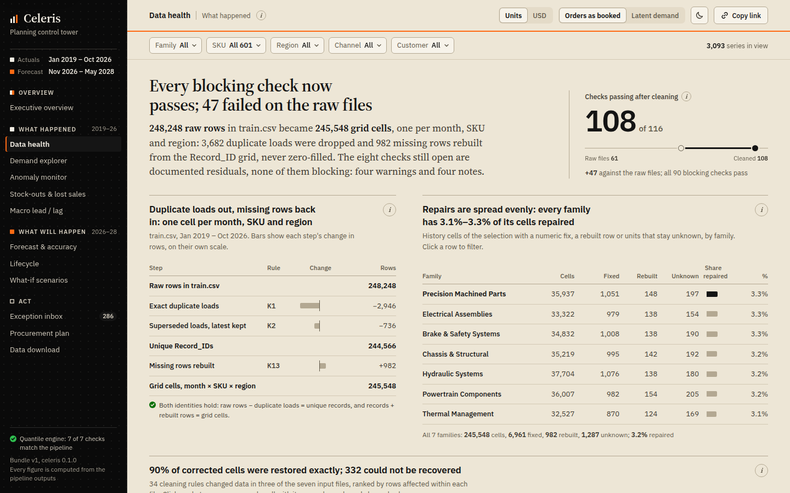
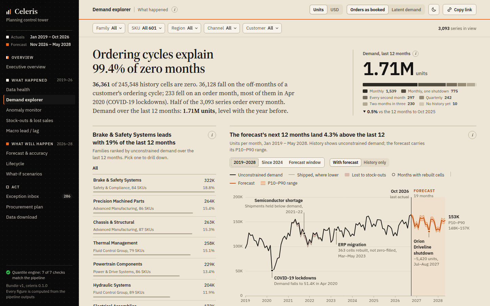
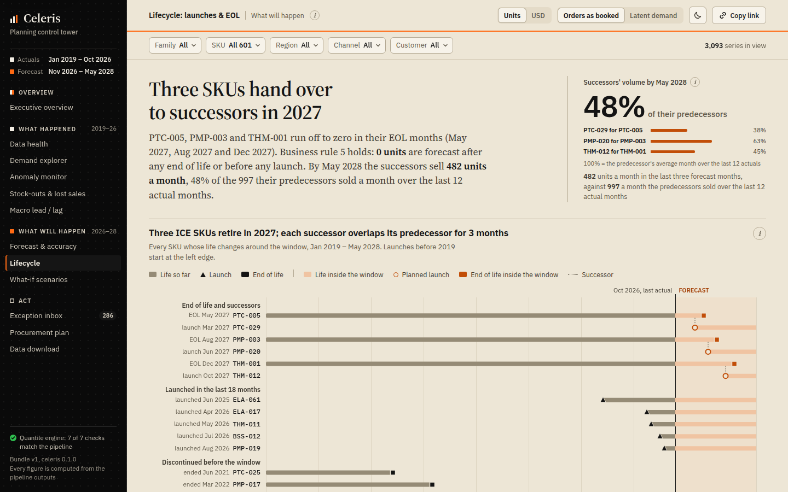
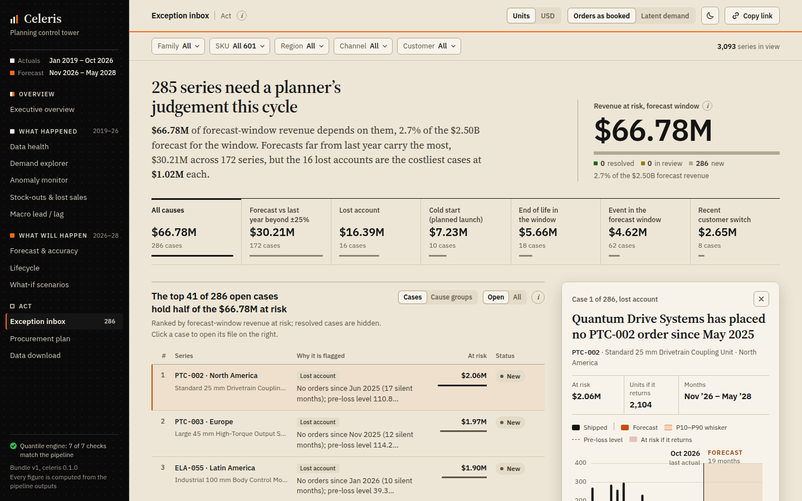

# Celeris Automobili Industrial: Demand Forecasting & Planning Control Tower

This project turns Celeris's raw ERP sales extract (about 600 SKUs, 7 product families, 6 regions, January 2019 to
October 2026) into a cleaned and audited demand history. It forecasts unconstrained demand, meaning what customers will
ask for when supply is not limited, for each of the 58,219 SKU × region × month rows from November 2026 to May 2028. One
command rebuilds every output from the seven raw CSV files, and a static dashboard with 12 views shows history and
forecast on one timeline for planners and managers.

**Terms used below.** A *series* is one SKU in one region (3,083 in history). A *cell* is one series in one month.
*WAPE* is Σ|actual − forecast| / Σ actual, and *bias* is Σ(forecast − actual) / Σ actual. Both are computed over the
selected cells, never as an average of per-series values. *P10 / P90* are the values the outcome should fall below with
10 % / 90 % probability.

## Headline results

Every number below is read from a pipeline output. The file is named in the last column.

| Area | Result | Source |
|---|---|---|
| Data repaired | 248,248 raw rows → 244,566 unique records (2,946 exact duplicate loads and 736 superseded restatements dropped, latest load kept) → a 245,548-cell grid. The 982 deleted rows are located exactly and kept as *missing*, never as zero. | `outputs/quality/dq_report.json` |
| | 6,932 records (2.83 %) carry a numeric error. Each falls into one of 13 error states with an exact arithmetic signature: 4,071 are restored exactly, 385 to within ±5 units, and 332 are unknown and masked. | `dq_report.json` → `summary.train_numeric_states`, check `TRN-NUM-TOTALS` |
| | 116 data-quality checks: 55 fail before cleaning. After cleaning, 0 errors remain and 4 warnings are documented (unknown values that are masked, not guessed). | `dq_report.json` → `summary` |
| | Cleaned units equal the stock-out file's `Shipped_Units` on 5,761 of 5,761 comparable rows. Without the repairs, history would show 2.6 % more units (12,030,253 vs 11,723,379) and USD 108.6 M more revenue (USD 8,684.4 M vs 8,575.9 M). | checks `ORC-UNITS-SHIPPED`, `TRN-NUM-TOTALS` |
| Unconstrained demand | 11,831,100 units requested vs 11,724,013 shipped (+0.91 %). For Electrical Assemblies the gap is +44.8 % in 2021 and +29.2 % in 2022 (chip shortage). | `dq_report.json` → check `DEM-UC-UPLIFT` |
| Lost sales | 106,925 units never shipped, worth USD 109.9 M. Electrical Assemblies accounts for 80,664 of those units (75 %). | `outputs/clean/train_clean.parquet` (`lost_units`) |
| Backtest accuracy | Four rolling forecast origins (2022-10, 2023-10, 2024-10, 2025-03), each forecasting 19 months ahead, scored against unconstrained demand on 225,942 cells. Final model: **WAPE 26.3 %, bias −0.2 %**. | `outputs/backtest/summary.json`, `metrics.csv` |
| | Baselines on the same cells: last-12-month mean 51.6 %, seasonal naive 38.7 %, intermittent-demand methods (Croston, SBA, TSB, ADIDA, IMAPA) 51.3–51.6 %, cycle-aware naive 31.2 %, global LightGBM 27.3 % (bias +2.1 %; not shipped). | `summary.json` → `ladder` |
| | Noise floor: a forecaster who knew each series' future level in hindsight scores 23.7 %. The final model is 2.7 WAPE points above it. Summed to family × month the WAPE is 3.5 %, and at total × month it is 2.1 %. | `summary.json` → `noise_floor_wape`; `metrics.csv` |
| Forecast | **2,793,254 units** over 2026-11 to 2028-05, with a P10–P90 range of 2.71 M to 2.88 M units for the 19-month total. That is ×1.035 the last 19 months of unconstrained demand. Revenue is USD 2.50 bn at assumed prices (2026 price +4.5 % in 2027, +4.0 % more in 2028). | `outputs/forecast/submission.csv`, `forecast.parquet`, `aggregates.csv` |
| | 8,842 rows are exactly 0: 8,382 scheduled off-months of a customer's ordering cycle, 304 rows of 16 lost accounts, and 156 rows after an announced end of life. | `outputs/clean/test_grid.parquet` |
| | The P10–P90 bands are calibrated to cover 80 % of backtest actuals at row, family × region × month and total × month level. Forecasts are bottom-up sums, so they add up exactly at family, region, channel and total level. | `outputs/forecast/uncertainty.json`; check `FC-HIERARCHY` |
| Dashboard | 12 views: the 5 required views and all 7 optional ones. They share filters (family, SKU, region, channel, customer). History is drawn in ink and the forecast in orange on one continuous timeline. An exception inbox lists 286 items for planners, ranked by revenue at risk (USD 66.8 M in total). No backend is needed. | `dashboard/`, `dashboard/public/data/exceptions.json` |

## What is original in the approach

1. **We reverse-engineered the synthetic data generator before modelling.** Ten forensic investigations, each checked
   by an independent skeptic review, were merged into `research/DATA_DOSSIER.md`. Every injected error turned out to
   leave an exact arithmetic signature. The cleaning rules are therefore exact, and the pipeline fails the build
   if a count moves.
2. **We decoded Record_ID as a grid.** `Record_ID` is the generator's row counter over a complete SKU × region × month
   grid. Decoding it gives each row's true SKU, region and month. It also locates the 982 deleted rows, fills the 737
   blank regions and repairs the 30 rows with year "2062". Two independent witnesses confirm the result: the load
   timestamp, and a region lookup that does not use Record_ID.
3. **We model scheduled ordering cycles and order accumulation.** Customers order monthly, every second month,
   quarterly, two months on and one off, or monthly with one annual shutdown month. 98.7 % of the 36,057 zero months in
   history are scheduled off-months. An order carries all the demand that built up since the previous order. We
   forecast monthly demand and then place it on each customer's cycle. A flat level placed on the cycle, with no
   seasonality at all, cuts backtest WAPE from 51.6 % (flat last-12-month mean) to 31.2 %.
4. **Our target is unconstrained demand.** Stock-outs hide demand, so we rebuilt the requested quantity from the
   stock-out file's exact accounting rules. That covers listed stock-outs, back-order catch-up, hidden stock-outs
   detected from their arithmetic, and the semiconductor allocation of 2021–22. Both training and scoring use this
   rebuilt demand (business rule 7).
5. **Each backtest origin sees only the data available at that time.** At every origin the whole demand state is
   rebuilt from data up to that month: cycles, lost accounts, customer switches, one-off orders, levels, seasonality,
   macro drivers and EV effects. A test scrambles all data after an origin and checks that the origin's forecasts do
   not change.
6. **A structural model explains each forecast.** The forecast is the product of a level, seasonality, moving
   holidays, a SKU-level macro path, an EV-adoption factor, a lifecycle factor and window events, placed on the
   ordering cycle. All seven factors are stored for every row. The dashboard's "forecast X-ray" draws them as a
   waterfall.
7. **The P10–P90 ranges add up.** Uncertainty is split into four variance components: order noise, series level,
   family × region, and a common period error. The range of *any* aggregate comes from one formula, never from summing
   row quantiles. Summing row P90s would give 3.92 M units for the 19-month total. The correct aggregate P90 is
   2.88 M.

## Quick start

### 1. Environment

The project needs Python 3.12 (`requires-python >=3.12,<3.13`). If your default `python3` is newer, name 3.12
explicitly.

```bash
# with uv
uv venv --python 3.12 .venv
uv pip install --python .venv/bin/python -e ".[test]"

# or with pip
python3.12 -m venv .venv
.venv/bin/pip install -e ".[test]"
```

### 2. Raw data

The seven provided CSV files go in `data/raw/`. That folder is not under version control.

```bash
mkdir -p data/raw
cp /path/to/student_data/*.csv data/raw/
ls data/raw
# events_calendar.csv  inventory_stockouts.csv  macro_indicators.csv  sample_submission.csv
# sku_master.csv  test.csv  train.csv
sha256sum data/raw/*.csv   # compare with "inputs" in outputs/quality/manifest.json
```

### 3. Run the pipeline and the tests

```bash
make all    # clean -> demand -> anomalies -> features -> backtest -> forecast -> export
make test   # fast test suite (224 tests; the slow end-to-end test is deselected)
```

`make all` writes everything under `outputs/` and the dashboard data under `dashboard/public/data/`. Each stage can also
run alone with `make clean-data`, `make demand`, `make anomalies`, `make features`, `make backtest`, `make forecast` or
`make export`, in that order. Running a stage deletes the outputs of every later stage. Two runs produce byte-identical
outputs, and `outputs/quality/manifest.json` records the SHA-256 of every input and output.

### 4. Open the dashboard

The built site, including its data, is in the repository, so Node is not needed to view it:

```bash
python3 -m http.server 8000 -d dashboard/dist
# then open http://localhost:8000
```

Opening `dashboard/dist/index.html` directly from disk does not work, because browsers block `fetch` from `file://`.
To rebuild the site after a pipeline run, use `make dashboard` (needs Node 20 or later). It runs the export, `npm ci`
and `npm run build`.

### Expected runtimes

| Command | Time | Notes |
|---|---|---|
| `make all` | about 10 min | Most of it is the backtest. |
| `make clean-data` | about 15 s | Cleaning stage only. |
| `make test` | under 3 min | Runs pipeline stages into temporary folders. Never writes to `outputs/`. |
| `make test-all` | about 20 min | Adds one slow test that runs `all` twice and compares hashes. Needs 2.5 GB of temporary disk. |
| `make dashboard` | a few minutes | `npm ci` downloads about 120 MB of packages. |

## Repository map

```
data/raw/            the seven provided CSV files (you add them; not in git)
src/celeris/         the pipeline package: python -m celeris <stage>
  cleaning/          keys, dates, labels, de-duplication, Record_ID grid, prices, numeric states, indicators, master data
  demand/            unconstrained demand, stock-out recovery, ordering cycles, account events, missing cells, forecast grid
  anomalies/         one-off orders, measured event effects, training masks, anomaly register, series profile
  features/          calendar, moving holidays, lags and rolling statistics, macro lead / lag, lifecycle, feature catalogue
  models/            baselines, intermittent methods, structural model, LightGBM, quantiles, the forecast stage
  backtest/          rolling-origin harness, metrics, uncertainty calibration
  quality/           checks, fix log, manifest, data-quality report
  export/            dashboard data bundle and exception rules
  reference/         the one hand-made lookup (label aliases) with its provenance
tests/               pytest suite: rules, invariants, oracle checks, no-leakage, contracts, reproducibility
outputs/             every pipeline output (committed): clean/, quality/, anomalies/, features/, backtest/, forecast/
dashboard/           React + TypeScript + ECharts app; dist/ is the built site; public/data/ is the data bundle
docs/                methodology, traceability, submission text, architecture, modelling, dashboard, design system,
                     problem statement, jury criteria, screenshots/
research/            forensic reports, skeptic reviews and DATA_DOSSIER.md (evidence of process; not read at runtime)
Makefile, pyproject.toml
```

## Where each requirement is delivered

The short form is below. The full matrix, with evidence and status for every cell, dashboard item, business rule and
the submission contract, is in [`docs/requirements_traceability.md`](docs/requirements_traceability.md).

| Workstream | Core | Advanced | Expert |
|---|---|---|---|
| 1. Cleaning | `src/celeris/cleaning/`; one row per Date-SKU-Region in `outputs/clean/train_clean.parquet` | 15 numeric states reconciled to the cent; unit, currency and pack errors fixed; missing rows ≠ zeros; indicators cleaned (`macro_clean.csv`) | `make all` + 225 tests; `outputs/quality/dq_report.json`, `fix_log.parquet`, `manifest.json` |
| 2. Anomalies | `outputs/anomalies/anomaly_register.csv` (11,799 rows, data errors vs real events) | Breaks, pre-buy, holidays, stock-outs; unconstrained demand (`demand_uc`) | 27 cycle changes, 23 customer switches, 16 lost accounts; master-data conflicts |
| 3. Features & drivers | `outputs/features/feature_catalogue.csv` (39 entries) | `macro_leadlag.csv`; family drivers and lags; event and lifecycle factors | Lag stability by origin and by era; EV shift by powertrain class |
| 4. Forecasting | 3 baselines + structural model; time-based backtest | Croston, SBA, TSB, ADIDA, IMAPA; LightGBM; 4 + 1 rolling origins, 19-month horizon | Cold starts, end of life, window events; P10/P50/P90; bottom-up coherence |
| 5. Dashboard | 5 required views | 7 optional views | 7 optional views, one design system; not yet deployed |

## Documents

| Document | What it covers |
|---|---|
| [`docs/methodology.md`](docs/methodology.md) | The method end to end, for the jury: framing, forensics, cleaning, anomalies, demand, features, models, validation, results, uncertainty, business impact, limitations |
| [`docs/requirements_traceability.md`](docs/requirements_traceability.md) | Every requirement → where it is delivered, the evidence, and its status; the gaps |
| [`docs/modelling.md`](docs/modelling.md) | Forecasting detail: every experiment, ablation, slice and calibration table |
| [`docs/architecture.md`](docs/architecture.md) | Repository layout, stage contracts, output schemas |
| [`docs/dashboard.md`](docs/dashboard.md) | Dashboard views, data bundle, how to run and deploy |
| [`docs/design_system.md`](docs/design_system.md) | The dashboard's visual system |
| [`docs/submission.md`](docs/submission.md) | Text for the hackathon portal and a 2-minute demo script |
| [`research/DATA_DOSSIER.md`](research/DATA_DOSSIER.md) | The forensic findings behind every cleaning and modelling rule |
| [`docs/problem_statement.md`](docs/problem_statement.md), [`docs/evaluation_criteria.md`](docs/evaluation_criteria.md) | The brief and the jury criteria |

## Dashboard screenshots

| | |
|---|---|
|  **Executive overview** |  **Data health** |
|  **Demand explorer** |  **Anomaly monitor** |
|  **Forecast & accuracy** |  **Stock-outs & lost sales** |
|  **Macro lead / lag** |  **Lifecycle** |
|  **What-if** |  **Exception inbox** |
|  **Procurement plan** |  **Data download** |

## Known issues

These are listed in full, ordered by importance, under "Gaps" in
[`docs/requirements_traceability.md`](docs/requirements_traceability.md#gaps).

- Fixed on 24 Nov 2026: the dashboard's aggregate P10–P90 ranges now include the common-error term `cv_common`
  (19-month total 2.71 M to 2.88 M, as in `outputs/forecast/aggregates.csv`), and its backtest figures pool the four
  decision folds on the cells every model forecast (final model 26.3 %, LightGBM 27.3 %, as in `summary.json`).
- The demo is not deployed yet.
