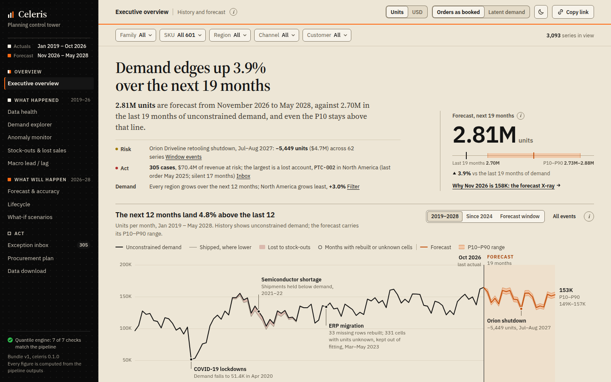
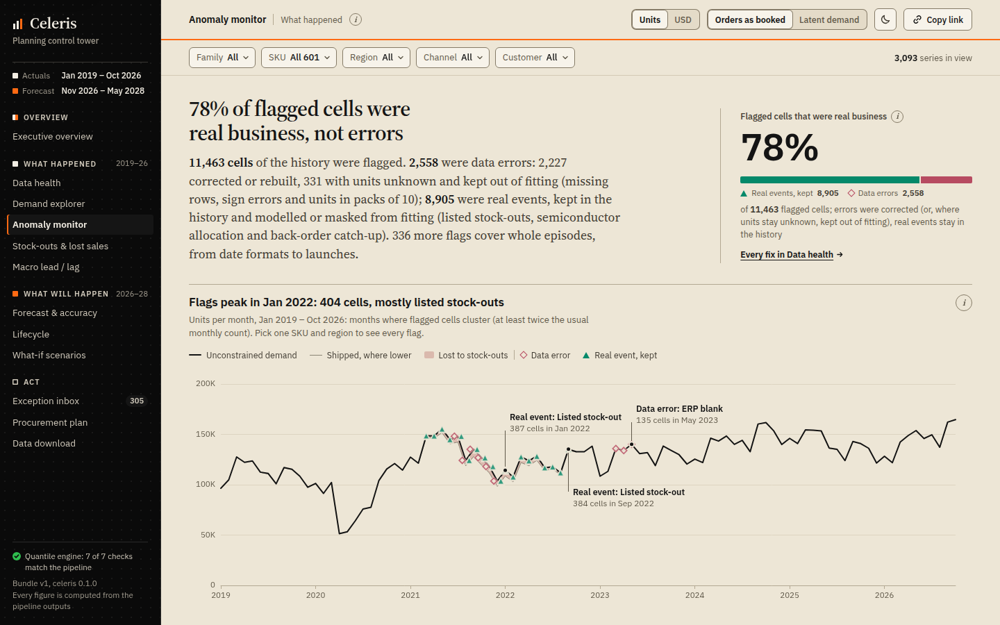
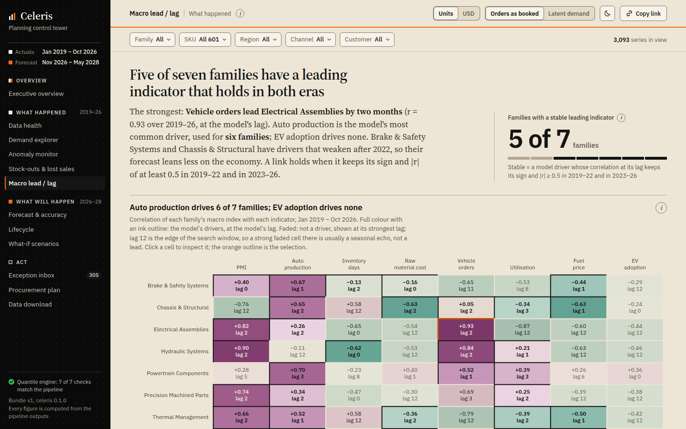
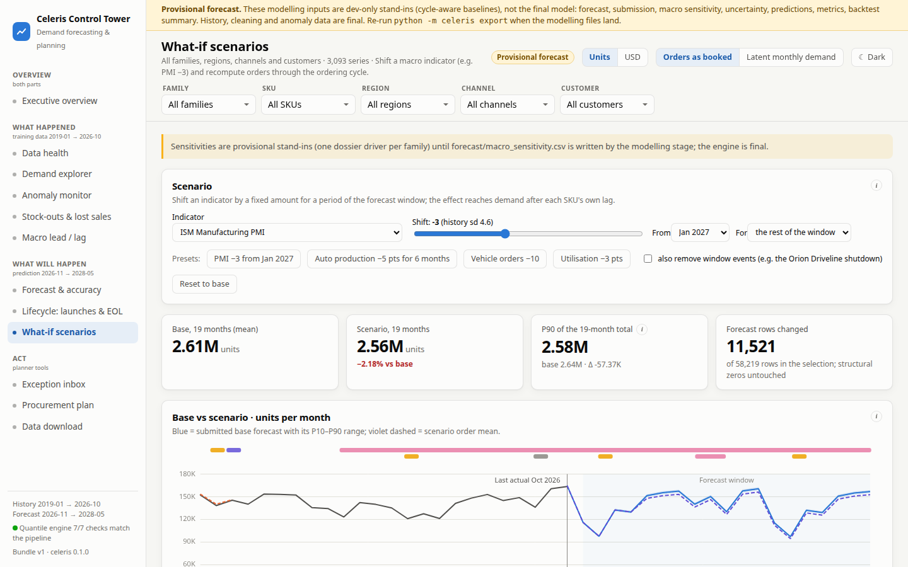
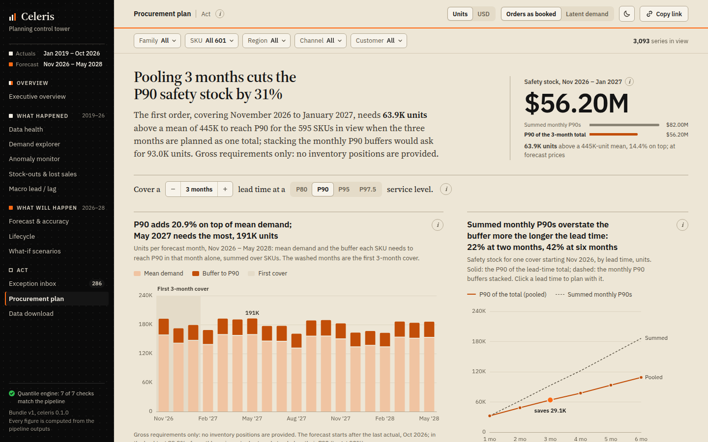
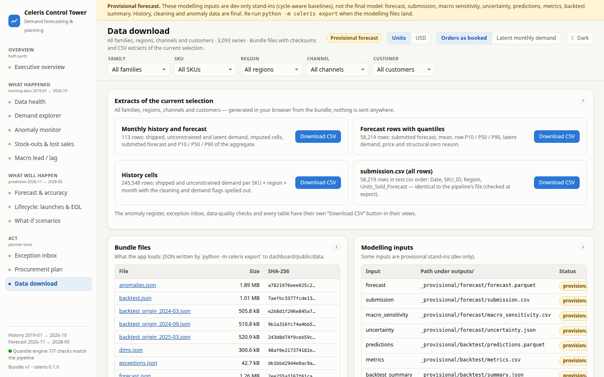

# Celeris Automobili Industrial: Demand Forecasting & Planning Control Tower

## Ten minutes with this submission

- **Open the demo: <https://pavankumar07s.github.io/celeris-control-tower/>** (a static site, no login).
  Repository: <https://github.com/Pavankumar07s/celeris-control-tower>. To view it locally, with nothing to build:
  `python3 -m http.server 8000 -d dashboard/dist`, then open http://localhost:8000.
- **Look at three views:**
  1. **Executive overview.** History and forecast on one timeline. The 19-month forecast is 2.81 M units with a
     P10–P90 range of 2.73 M–2.88 M. It proves that the plan continues the history and that its ranges add up: the
     rail reads "Quantile engine: 7 of 7 checks match the pipeline".
  2. **Data health.** 248,248 raw rows become 245,548 grid cells, and every blocking check passes after cleaning.
     Click an example cell to see its raw value, the rule and the cleaned value. It proves that the cleaning is exact
     and auditable.
  3. **Forecast & accuracy.** Backtest WAPE 26.1 % against 31.1 % for cycle-aware naive and 38.6 % for seasonal
     naive, with an in-hindsight floor of 23.5 % (all pooled over the four folds' cells). Replay any origin in the
     backtest time machine and open the forecast X-ray. It proves the accuracy claim and shows why each number is what
     it is.
- **The three results that matter:**
  1. **Accuracy.** WAPE 26.1 % and bias +0.2 % over four rolling 19-month backtest origins (225,942 cells), against
     38.6 % for seasonal naive and an in-hindsight floor of 23.5 %. Summed to total × month, the WAPE is 1.8 %.
  2. **Demand that shipments hid.** 106,925 units, worth USD 109.9 M, were requested and never shipped. The forecast
     targets requested (unconstrained) demand: 2,805,199 units for 2026-11 to 2028-05, P10–P90 2.73 M–2.88 M.
  3. **Data repaired exactly.** Each of the 6,932 numeric errors (2.83 % of records) has an exact arithmetic signature.
     Of 116 data-quality checks, 55 fail on the raw data and no error remains after cleaning; cleaned units equal the
     stock-out file's shipped units on 5,761 of 5,761 rows.
- **Reproduce it:** every output and the built dashboard are committed, so every result can be inspected without the
  data. The seven raw CSV files are distributed by the hackathon organisers and are not in the repository; with them in
  `data/raw/`, `make all` rebuilds every output byte for byte in about 11 minutes, and `make test` runs 234 tests in
  about 3 minutes. Details in [Quick start](#quick-start).
- **Limitations, stated plainly:** [`docs/methodology.md`](docs/methodology.md) section 14. In particular, the
  optimisation round's confirmation origins were partly seen during the round (section 8.4), and the pipeline is
  pinned to this extract by its asserted counts (section 3).

## What this is

This project turns Celeris's raw ERP sales extract (about 600 SKUs, 7 product families, 6 regions, January 2019 to
October 2026) into a cleaned and audited demand history. It forecasts unconstrained demand, meaning what customers will
ask for when supply is not limited, for each of the 58,219 SKU × region × month rows from November 2026 to May 2028. One
command rebuilds every output from the seven raw CSV files, and a static dashboard with 12 views shows history and
forecast on one timeline for planners and managers.

**Terms used below.** A *series* is one SKU in one region: 3,083 in history. The dashboard's "3,093 series in view"
adds the 10 series of planned launches, which have no history. A *cell* is one series in one month. *WAPE* is
Σ|actual − forecast| / Σ actual, and *bias* is Σ(forecast − actual) / Σ actual. Both are computed over the selected
cells, never as an average of per-series values; backtest figures are pooled over the scored cells of the four
backtest folds, as the dashboard shows them. *P10 / P90* are the values the outcome should fall below with 10 % /
90 % probability.

**Three terms you meet on screen.** *Latent demand* is a series' underlying monthly demand before it is grouped into
orders: a customer who orders every quarter has latent demand every month but places an order only every third month.
*Cycle-aware naive* is the simplest benchmark that knows the ordering calendar: a flat level placed on each customer's
ordering cycle, with no seasonality. The *in-hindsight floor* is the error of a forecaster that knew each series' true
level over the forecast period; it is the order noise that no honest forecast can remove.

## Headline results

Every number below is read from a pipeline output. The file is named in the last column.

| Area | Result | Source |
|---|---|---|
| Data repaired | 248,248 raw rows → 244,566 unique records (2,946 exact duplicate loads and 736 superseded restatements dropped, latest load kept) → a 245,548-cell grid. The 982 deleted rows are located exactly and kept as *missing*, never as zero. | `outputs/quality/dq_report.json` |
| | 6,932 records (2.83 %) carry a numeric error. Each falls into one of 13 error states with an exact arithmetic signature: 4,071 records have their units restored exactly, 2,144 have their price or revenue recomputed exactly (units untouched), 385 pack-of-10 records have their units restored to within ±5 units, and 332 have units unknown and are masked. | `dq_report.json` → `summary.train_numeric_states` (N1–N6; N7–N10 and N13; N11; N12), check `TRN-NUM-TOTALS` |
| | 116 data-quality checks: 55 fail before cleaning. After cleaning, 0 errors remain and 4 warnings are documented (unknown values that are masked, not guessed). The dashboard's Data health view counts the 90 blocking (`error`) checks: 47 of them fail on the raw files and all pass after cleaning. | `dq_report.json` → `summary`, `checks` |
| | Cleaned units equal the stock-out file's `Shipped_Units` on 5,761 of 5,761 comparable rows. Without the repairs, history would show 2.6 % more units (12,030,253 vs 11,723,379) and USD 108.6 M more revenue (USD 8,684.4 M vs 8,575.9 M). | checks `ORC-UNITS-SHIPPED`, `TRN-NUM-TOTALS` |
| Unconstrained demand | 11,831,100 units requested vs 11,724,013 shipped (+0.91 %). For Electrical Assemblies the gap is +44.8 % in 2021 and +29.2 % in 2022 (chip shortage). | `dq_report.json` → check `DEM-UC-UPLIFT` |
| Lost sales | 106,925 units never shipped, worth USD 109.9 M. Electrical Assemblies accounts for 80,664 of those units (75 %). | `outputs/clean/train_clean.parquet` (`lost_units`) |
| Backtest accuracy | Four rolling forecast origins (2022-10, 2023-10, 2024-10, 2025-03), each forecasting 19 months ahead, scored against unconstrained demand on 225,942 cells. Final model: **WAPE 26.1 %, bias +0.2 %** (per origin 28.3 %, 26.0 %, 25.1 %, 25.1 %). It includes the one change kept by a declared optimisation round, a converged factor fit; three confirmation origins agree with it, but they were partly seen during the round, so they are a consistency check, not a clean hold-out (`docs/methodology.md` 8.4). | `outputs/backtest/summary.json`, `metrics.csv` |
| | Baselines on the same cells: last-12-month mean 51.6 %, seasonal naive 38.6 %, intermittent-demand methods (Croston, SBA, TSB, ADIDA, IMAPA) 51.2–51.6 %, cycle-aware naive 31.1 %, global LightGBM 26.7 % (bias +1.5 %; not shipped). | `metrics.csv` (sums over the four folds); `dashboard/public/data/meta.json` → `backtest.ladder` |
| | In-hindsight floor: a forecaster who knew each series' future level scores 23.5 % on the same cells. Summed to family × month the final model's WAPE is 3.1 %, and at total × month it is 1.8 %. | `metrics.csv` (`oracle`; levels `family`, `total`) |
| Forecast | **2,805,199 units** over 2026-11 to 2028-05, with a P10–P90 range of 2.73 M to 2.88 M units for the 19-month total. That is ×1.039 the last 19 months of unconstrained demand (×1.044 against the known cells alone; 212 history cells of unknown demand are filled for display). Revenue is USD 2.52 bn at assumed prices (2026 price +4.5 % in 2027, +4.0 % more in 2028). | `outputs/forecast/submission.csv`, `forecast.parquet`, `aggregates.csv` |
| | 8,842 rows are exactly 0: 8,382 scheduled off-months of a customer's ordering cycle, 304 rows of 16 lost accounts, and 156 rows after an announced end of life. | `outputs/clean/test_grid.parquet` |
| | The P10–P90 bands are calibrated, in sample on the four folds, to cover 80 % of monthly backtest actuals at row, family × region × month and total × month level. Leaving one origin out, total × month coverage ranges from 47 % (2022-10) to 100 % (2025-03). Forecasts are bottom-up sums, so they add up exactly at family, region, channel and total level. | `outputs/forecast/uncertainty.json`, `summary.json` → `coverage`; check `FC-HIERARCHY` |
| Dashboard | Live at <https://pavankumar07s.github.io/celeris-control-tower/>. 12 views: the 5 required views and all 7 optional ones. They share filters (family, SKU, region, channel, customer). History is drawn in ink and the forecast in orange on one continuous timeline. An exception inbox lists 305 cases on 304 series for planners, ranked by revenue at risk (USD 70.4 M in total). No backend is needed. | `dashboard/`, `dashboard/public/data/exceptions.json` |

Backtest WAPE and bias above are pooled over the scored cells of the four folds, as on the dashboard.
`outputs/backtest/summary.json` also stores the mean of the four folds' values, on which the project's decision rules
were applied; [`docs/methodology.md`](docs/methodology.md) section 9.1 explains the two statistics.

## What is original in the approach

1. **We reverse-engineered the synthetic data generator before modelling.** Ten forensic investigations, each checked
   by an independent skeptic review, were merged into `research/DATA_DOSSIER.md`. Every injected error turned out to
   leave an exact arithmetic signature. The cleaning rules are therefore exact, and the pipeline fails the build
   if a count moves. That pins it to this extract on purpose; a monthly production run would need the counts
   re-baselined or turned into monitored thresholds (`docs/methodology.md` section 3).
2. **We decoded Record_ID as a grid.** `Record_ID` is the generator's row counter over a complete SKU × region × month
   grid. Decoding it gives each row's true SKU, region and month. It also locates the 982 deleted rows, fills the 737
   blank regions and repairs the 30 rows with year "2062". Two independent witnesses confirm the result: the load
   timestamp, and a region lookup that does not use Record_ID.
3. **We model scheduled ordering cycles and order accumulation.** Customers order monthly, every second month,
   quarterly, two months on and one off, or monthly with one annual shutdown month. 98.7 % of the 36,057 zero months in
   history are scheduled off-months. An order carries all the demand that built up since the previous order. We
   forecast monthly demand and then place it on each customer's cycle. A flat level placed on the cycle, with no
   seasonality at all, cuts backtest WAPE from 51.6 % (flat last-12-month mean) to 31.1 %.
4. **Our target is unconstrained demand.** Stock-outs hide demand, so we rebuilt the requested quantity from the
   stock-out file's exact accounting rules. That covers listed stock-outs, back-order catch-up, hidden stock-outs
   detected from their arithmetic, and the semiconductor allocation of 2021–22. Both training and scoring use this
   rebuilt demand (business rule 7).
5. **Each backtest origin sees only the data available at that time.** At every origin the whole demand state is
   rebuilt from data up to that month: cycles, lost accounts, customer switches, one-off orders, levels, seasonality,
   macro drivers and EV effects. A test scrambles all data after an origin and checks that the origin's forecasts do
   not change.
6. **A structural model explains each forecast.** The forecast is the product of a level, seasonality, moving
   holidays, a SKU-level macro path, an EV-adoption factor, a lifecycle factor and window events, placed on the
   ordering cycle. All seven factors are stored for every row. The dashboard's "forecast X-ray" draws them as a
   waterfall.
7. **The P10–P90 ranges add up.** Uncertainty is split into four variance components: order noise, series level,
   family × region, and a common period error. The range of *any* aggregate comes from one formula, never from summing
   row quantiles. Summing row P90s would give 3.92 M units for the 19-month total. The correct aggregate P90 is
   2.88 M.

## Quick start

Linux or macOS. On Windows use WSL: the backtest's worker processes use the `forkserver` start method, which Windows
does not have. (`CELERIS_WORKERS=1` keeps the backtest in one process, but the project is not tested on Windows.)

### 1. Environment

The project needs Python 3.12 (`requires-python >=3.12,<3.13`). If your default `python3` is newer, name 3.12
explicitly.

```bash
# with uv
uv venv --python 3.12 .venv
uv pip install --python .venv/bin/python -e ".[test]"

# or with pip
python3.12 -m venv .venv
.venv/bin/pip install -e ".[test]"
```

**Exact reproduction.** `pyproject.toml` allows compatible version ranges. `requirements.lock.txt` pins the exact
versions in which the committed outputs were built, and with which a fresh clone rebuilt all of them byte for byte
(release audit, 25 Nov 2026). To install exactly those:

```bash
uv venv --python 3.12 .venv
uv pip install --python .venv/bin/python -r requirements.lock.txt
uv pip install --python .venv/bin/python -e . --no-deps
```

### 2. Raw data

The seven CSV files of the dataset are distributed by the hackathon organisers and are **not in this repository**; put
them in `data/raw/`. You do not need them to inspect the results: every pipeline output (`outputs/`) and the built
dashboard (`dashboard/dist`) are committed. Without them, every pipeline command stops with a short message naming the
missing files.

```bash
mkdir -p data/raw
cp /path/to/student_data/*.csv data/raw/
ls data/raw
# events_calendar.csv  inventory_stockouts.csv  macro_indicators.csv  sample_submission.csv
# sku_master.csv  test.csv  train.csv
sha256sum data/raw/*.csv   # compare with "inputs" in outputs/quality/manifest.json
```

### 3. Run the pipeline and the tests

```bash
make all    # clean -> demand -> anomalies -> features -> backtest -> forecast -> export
make test   # fast test suite: 234 tests; the slow end-to-end test is deselected
```

Without `make`: `.venv/bin/python -m celeris all` and `.venv/bin/python -m pytest`.

`make all` writes everything under `outputs/` and the dashboard data under `dashboard/public/data/`. Each stage can also
run alone with `make clean-data`, `make demand`, `make anomalies`, `make features`, `make backtest`, `make forecast` or
`make export`, in that order. Running a stage deletes the outputs of every later stage. Two runs produce byte-identical
outputs, and `outputs/quality/manifest.json` records the SHA-256 of every input and output.

The cleaning stage asserts 192 counts established by the data forensics (`EXPECTED` in `src/celeris/config.py`) and
stops if any of them moves. That is deliberate for this audited extract; a new extract needs those counts
re-baselined first (`docs/methodology.md` section 3).

### 4. Open the dashboard

The built site, including its data, is in the repository, so Node is not needed to view it:

```bash
python3 -m http.server 8000 -d dashboard/dist
# then open http://localhost:8000
```

Opening `dashboard/dist/index.html` directly from disk does not work, because browsers block `fetch` from `file://`.
To rebuild the site after a pipeline run, use `make dashboard` (needs Node 20.19 or later, as Vite 7 requires). It
runs the export, `npm ci` and `npm run build`.

### Expected runtimes

| Command | Time | Notes |
|---|---|---|
| `make all` | about 11 min | Most of it is the backtest (about 10 min), which runs its structural fits in three worker processes (`CELERIS_WORKERS=N make all` or `python -m celeris all --workers N` to change; outputs are identical for any N). Peak about 2.7 GB of memory. |
| `make clean-data` | about 10 s | Cleaning stage only. |
| `make test` | about 3 min | Runs pipeline stages into temporary folders. Never writes to `outputs/`. Peak about 2.6 GB of memory. |
| `make test-all` | about 24 min | Adds one slow test that runs `all` twice into temporary folders and compares every output, the dashboard bundle included. Needs about 0.2 GB of temporary disk; peak about 4 GB of memory. |
| `make dashboard` | a few minutes | `npm ci` downloads about 120 MB of packages. |
| `make source-zip` | seconds | Writes `dist_zip/celeris_source.zip` for the portal's source upload (see below). |

### Source zip for the portal

`make source-zip` writes `dist_zip/celeris_source.zip` with `git archive` from the committed tree (`HEAD`): commit
first. It leaves out `dashboard/public/data`, which is a copy of `dashboard/dist/data` that `make export` rewrites
(`.gitattributes`); the built site in `dashboard/dist` stays complete. Untracked files (`data/raw/`, `node_modules/`,
`research/scratch/`) are never included. The size is in [`docs/submission.md`](docs/submission.md), "Source Code
upload".

## Repository map

```
data/raw/            the seven provided CSV files (you add them; not in git)
src/celeris/         the pipeline package: python -m celeris <stage>
  cleaning/          keys, dates, labels, de-duplication, Record_ID grid, prices, numeric states, indicators, master data
  demand/            unconstrained demand, stock-out recovery, ordering cycles, account events, missing cells, forecast grid
  anomalies/         one-off orders, measured event effects, training masks, anomaly register, series profile
  features/          calendar, moving holidays, lags and rolling statistics, macro lead / lag, lifecycle, feature catalogue
  models/            baselines, intermittent methods, structural model, LightGBM, quantiles, the forecast stage
  backtest/          rolling-origin harness, metrics, uncertainty calibration
  quality/           checks, fix log, manifest, data-quality report
  export/            dashboard data bundle and exception rules
  reference/         the one hand-made lookup (label aliases) with its provenance
tests/               pytest suite: rules, invariants, oracle checks, no-leakage, contracts, reproducibility
  fixtures/reference/  outputs of the forensic investigations that the cross-check tests compare against
outputs/             every pipeline output (committed): clean/, quality/, anomalies/, features/, backtest/, forecast/
dashboard/           React + TypeScript + ECharts app; dist/ is the built site; public/data/ is the data bundle
docs/                methodology, traceability, submission text, architecture, modelling, optimisation log, dashboard,
                     design system, problem statement, jury criteria, screenshots/
  third_party/       licences and notices of the bundled fonts and libraries (NOTICE.md)
research/            forensic reports, skeptic reviews, DATA_DOSSIER.md and the optimisation lab's scripts (evidence of
                     process; not read at runtime). research/scratch/, the working files these reports cite, is not
                     included in the repository.
Makefile, pyproject.toml, requirements.lock.txt (exact Python versions), .gitattributes (what the source zip leaves out)
```

## Where each requirement is delivered

The short form is below. The full matrix, with evidence and status for every cell, dashboard item, business rule and
the submission contract, is in [`docs/requirements_traceability.md`](docs/requirements_traceability.md).

| Workstream | Core | Advanced | Expert |
|---|---|---|---|
| 1. Cleaning | `src/celeris/cleaning/`; one row per Date-SKU-Region in `outputs/clean/train_clean.parquet` | 15 numeric states reconciled to the cent; unit, currency and pack errors fixed; missing rows ≠ zeros; indicators cleaned (`macro_clean.csv`) | `make all` + 235 tests; `outputs/quality/dq_report.json`, `fix_log.parquet`, `manifest.json` |
| 2. Anomalies | `outputs/anomalies/anomaly_register.csv` (11,799 rows, data errors vs real events) | Breaks, pre-buy, holidays, stock-outs; unconstrained demand (`demand_uc`) | 27 cycle changes, 23 customer switches, 16 lost accounts; master-data conflicts |
| 3. Features & drivers | `outputs/features/feature_catalogue.csv` (39 entries) | `macro_leadlag.csv`; family drivers and lags; event and lifecycle factors | Lag stability by origin and by era; EV shift by powertrain class |
| 4. Forecasting | 3 baselines + structural model; time-based backtest | Croston, SBA, TSB, ADIDA, IMAPA; LightGBM; 4 + 1 rolling origins, 19-month horizon | Cold starts, end of life, window events; P10/P50/P90; bottom-up coherence |
| 5. Dashboard | 5 required views | 7 optional views | 7 optional views, one design system; deployed as a static site on GitHub Pages |

## Documents

| Document | What it covers |
|---|---|
| [`docs/methodology.md`](docs/methodology.md) | The method end to end, for the jury: framing, forensics, cleaning, anomalies, demand, features, models, validation, results, uncertainty, business impact, limitations |
| [`docs/requirements_traceability.md`](docs/requirements_traceability.md) | Every requirement → where it is delivered, the evidence, and its status; the gaps |
| [`docs/modelling.md`](docs/modelling.md) | Forecasting detail: every experiment, ablation, slice and calibration table |
| [`docs/optimisation_log.md`](docs/optimisation_log.md) | The lab notebook of the optimisation round, experiment by experiment |
| [`docs/architecture.md`](docs/architecture.md) | Repository layout, stage contracts, output schemas |
| [`docs/dashboard.md`](docs/dashboard.md) | Dashboard views, data bundle, how to run and deploy |
| [`docs/design_system.md`](docs/design_system.md) | The dashboard's visual system |
| [`docs/submission.md`](docs/submission.md) | Text for the hackathon portal and a 2-minute demo script |
| [`research/DATA_DOSSIER.md`](research/DATA_DOSSIER.md) | The forensic findings behind every cleaning and modelling rule |
| [`docs/problem_statement.md`](docs/problem_statement.md), [`docs/evaluation_criteria.md`](docs/evaluation_criteria.md) | The brief and the jury criteria |
| [`docs/third_party/NOTICE.md`](docs/third_party/NOTICE.md) | Third-party fonts and libraries with their licences (the fonts are under the SIL Open Font License) |

## Dashboard screenshots

| | |
|---|---|
|  **Executive overview** |  **Data health** |
|  **Demand explorer** |  **Anomaly monitor** |
|  **Forecast & accuracy** |  **Stock-outs & lost sales** |
|  **Macro lead / lag** |  **Lifecycle** |
|  **What-if** |  **Exception inbox** |
|  **Procurement plan** |  **Data download** |

## Known issues

No open item is known. Fixed items are listed under "Gaps" in
[`docs/requirements_traceability.md`](docs/requirements_traceability.md#gaps), and the limits of the method in
[`docs/methodology.md`](docs/methodology.md) section 14.
