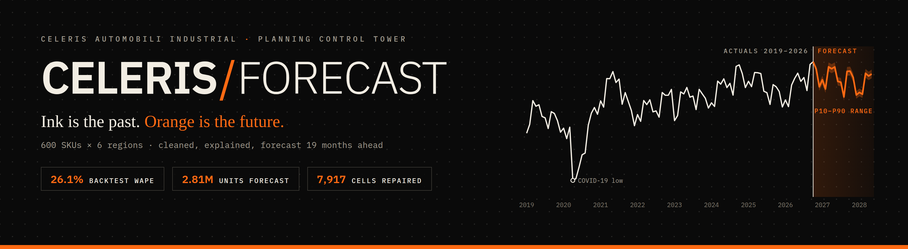
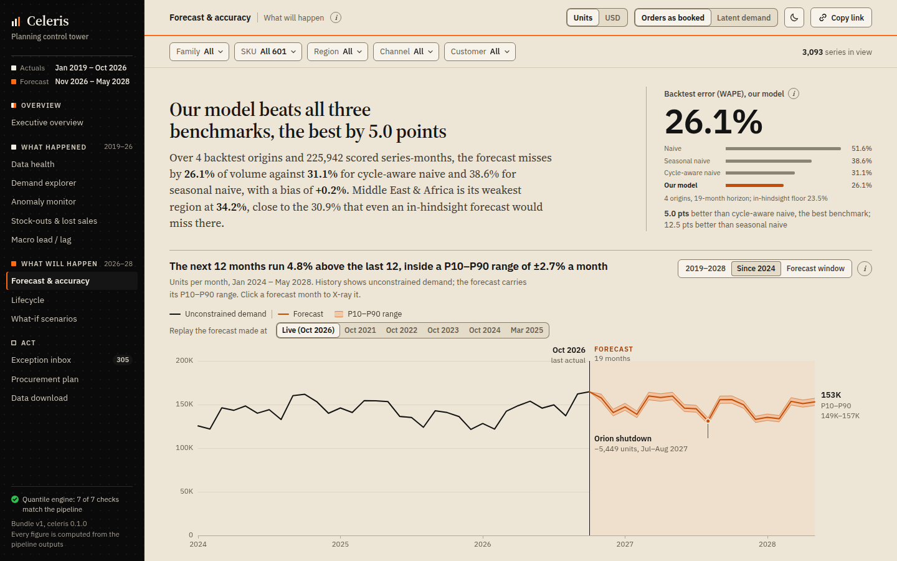
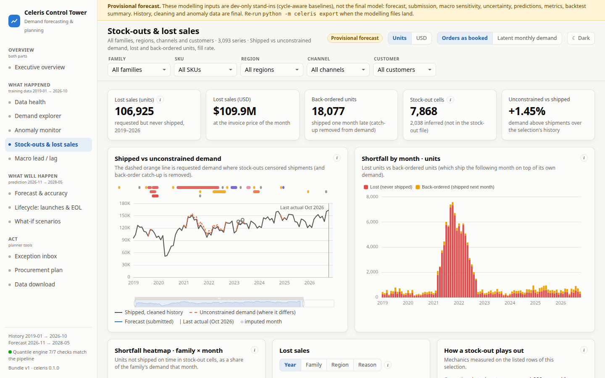

<p align="center"><a href="https://pavankumar07s.github.io/celeris-control-tower/"></a></p>

<p align="center">
  <a href="https://pavankumar07s.github.io/celeris-control-tower/"><b>Open the live dashboard</b></a> ·
  <a href="docs/methodology.md">How it works</a> ·
  <a href="#run-it-yourself">Run it yourself</a> ·
  <a href="docs/submission.md">Submission text</a>
</p>

# Celeris: Demand Forecasting & Planning Control Tower

**In one sentence:** we took a messy sales history for an automotive parts supplier, cleaned it, explained what
happened in it, forecast demand for the next 19 months, and put it all in a dashboard that planners can use.

## The dashboard

**Live:** <https://pavankumar07s.github.io/celeris-control-tower/> — no login, nothing to install.

Black is the past, orange is the future. Start with these three views:

- **Executive overview** — the 19-month outlook, the risks and what to act on, on one screen.
- **Data health** — how 248,248 raw rows became a clean history; click any cell to see the raw value, the rule and
  the fix.
- **Forecast & accuracy** — the accuracy table below, plus a "time machine" that replays past forecasts.

| | |
|---|---|
|  **Executive overview** |  **Forecast & accuracy** |
|  **Data health** |  **Exception inbox** |
|  **Demand explorer** |  **Stock-outs & lost sales** |

All 12 views are in [`docs/screenshots/`](docs/screenshots/) and described in [`docs/dashboard.md`](docs/dashboard.md).

## The problem

Celeris sells about **600 parts** (7 product families) in **6 regions**. We were given 8 years of sales records
(January 2019 to October 2026) and asked to predict monthly demand for every part in every region from
**November 2026 to May 2028**.

The data was deliberately messy: duplicate rows, missing rows, wrong dates, prices in the wrong currency, units in the
wrong scale, and months where Celeris ran out of stock, so sales were lower than real demand.

## What we built

| Step | What it does | Key number |
|---|---|---|
| **1. Clean** | Fixes every data error with an exact rule and logs each change | 7,917 history cells repaired; 0 errors left |
| **2. Explain** | Separates data errors from real events (stock-outs, lost customers, holidays, the chip shortage) | 11,799 entries in the anomaly register |
| **3. Recover lost demand** | Rebuilds what customers actually asked for in months when stock ran out | 106,925 units (USD 109.9 M) were never shipped |
| **4. Forecast** | Predicts 19 months of demand per part and region, with a low–high range | 2.81 M units (range 2.73 M – 2.88 M) |
| **5. Show** | A 12-view dashboard with history and forecast on one timeline | All 5 required + 7 optional views |

## How good is the forecast?

We tested the model the honest way: pretend it is an earlier date, forecast the next 19 months using only the data
available then, and compare with what really happened. We did this from four different starting points.

| Method | Average miss (WAPE) — lower is better |
|---|---|
| Simple average of the last 12 months | 51.6 % |
| Same month last year ("seasonal naive") | 38.6 % |
| A flat level that knows each customer's ordering calendar | 31.1 % |
| Machine-learning model (LightGBM) | 26.7 % |
| **Our model** | **26.1 %** |
| Best possible, even knowing the future level (the "in-hindsight floor") | 23.5 % |

Our model is only 2.6 points above the floor of what any forecast can achieve, and it is almost unbiased (+0.2 %).
Added up to monthly totals, the miss is just **1.8 %**.

*WAPE* = total absolute error ÷ total actual demand.

## What makes it different

1. **We cracked how the data was made.** The dataset is synthetic. We found that every injected error leaves an exact
   arithmetic fingerprint, so each one is fixed exactly, not guessed.
2. **The record ID is a map.** `Record_ID` counts through every part × region × month in order. Decoding it tells us
   the true part, region and month of every row and exactly which 982 rows were deleted.
3. **Zeros are scheduled, not random.** Customers order monthly, every two months or every quarter. 98.7 % of the zero
   months are just "not an order month". Knowing each customer's calendar alone cuts the error from 51.6 % to 31.1 %.
4. **We forecast real demand, not shipments.** Stock-outs hide demand, so we rebuild what customers asked for and
   forecast that.
5. **Every forecast explains itself.** Each number is the product of seven parts (level, season, holidays, economy,
   EV adoption, product lifecycle, events). The dashboard's "forecast X-ray" shows them.
6. **The ranges add up.** The low–high range of any total (a family, a region, the whole company) is calculated
   correctly, not by adding up individual ranges.

## Run it yourself

You can see every result without running anything: all outputs and the built dashboard are in the repository.

**View the dashboard locally**

```bash
python3 -m http.server 8000 -d dashboard/dist    # then open http://localhost:8000
```

**Rebuild everything from the raw data** (Linux or macOS; Python 3.12)

```bash
# 1. set up
uv venv --python 3.12 .venv
uv pip install --python .venv/bin/python -e ".[test]"

# 2. add the data: the 7 CSV files from the hackathon organisers (not in this repository)
mkdir -p data/raw && cp /path/to/student_data/*.csv data/raw/

# 3. run
make all     # about 11 minutes; rebuilds every output byte for byte
make test    # 234 tests, about 3 minutes
```

The forecast file is `outputs/forecast/submission.csv` (58,219 rows).

<details>
<summary>More details: exact versions, Windows, running single stages, rebuilding the dashboard</summary>

- **Exact versions.** `requirements.lock.txt` pins the library versions the outputs were built with:
  `uv pip install --python .venv/bin/python -r requirements.lock.txt` then
  `uv pip install --python .venv/bin/python -e . --no-deps`.
- **Without `make`:** `.venv/bin/python -m celeris all` and `.venv/bin/python -m pytest`.
- **Single stages:** `make clean-data`, `make demand`, `make anomalies`, `make features`, `make backtest`,
  `make forecast`, `make export` (in that order).
- **Windows:** use WSL. The backtest uses three worker processes; `CELERIS_WORKERS=1` runs it in one.
- **Slow full check:** `make test-all` (about 24 minutes) runs the whole pipeline twice and checks the outputs are
  identical.
- **Rebuild the dashboard** after a pipeline run: `make dashboard` (needs Node 20.19 or later).
- **Source zip for the portal:** `make source-zip` writes `dist_zip/celeris_source.zip` (about 39 MB).
- **This extract only.** The cleaning stage checks 192 counts found during the data investigation and stops if any
  changes. That is on purpose for this dataset; new data would need those counts updated first.

</details>

## What's in the repository

```
src/celeris/   the pipeline (clean → demand → anomalies → features → backtest → forecast → export)
outputs/       every result: cleaned data, quality report, anomaly register, backtest, forecast
dashboard/     the web dashboard (dist/ is the ready-to-open site)
docs/          methodology, requirements checklist, submission text, screenshots
research/      the data investigation reports behind every rule
tests/         234 automated tests
```

## Learn more

| If you want to… | Read |
|---|---|
| Understand the whole method | [`docs/methodology.md`](docs/methodology.md) |
| Check every requirement is covered | [`docs/requirements_traceability.md`](docs/requirements_traceability.md) |
| See every model experiment | [`docs/modelling.md`](docs/modelling.md) and [`docs/optimisation_log.md`](docs/optimisation_log.md) |
| See what we found in the data | [`research/DATA_DOSSIER.md`](research/DATA_DOSSIER.md) |
| Know the limitations | [`docs/methodology.md`](docs/methodology.md), section 14 |
| Read the hackathon brief | [`docs/problem_statement.md`](docs/problem_statement.md) |

## Licence

[MIT](LICENSE). The bundled fonts keep their own licence ([notice](docs/third_party/NOTICE.md)). The hackathon dataset is
not included.
